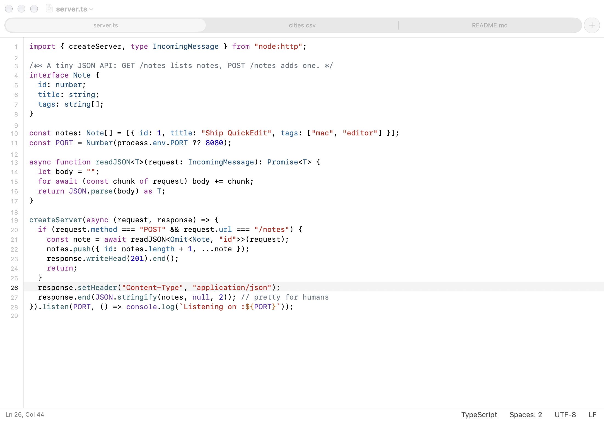
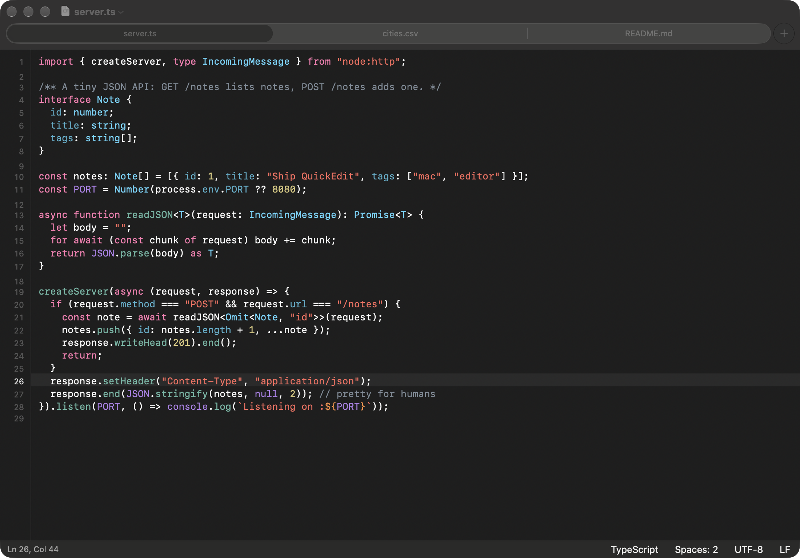
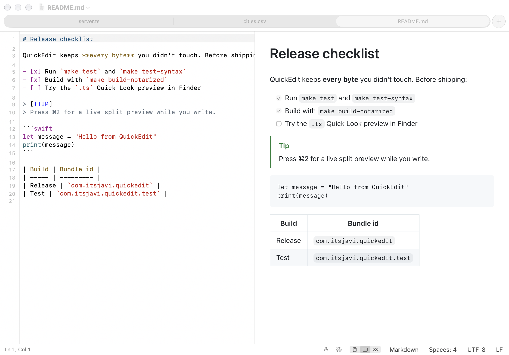
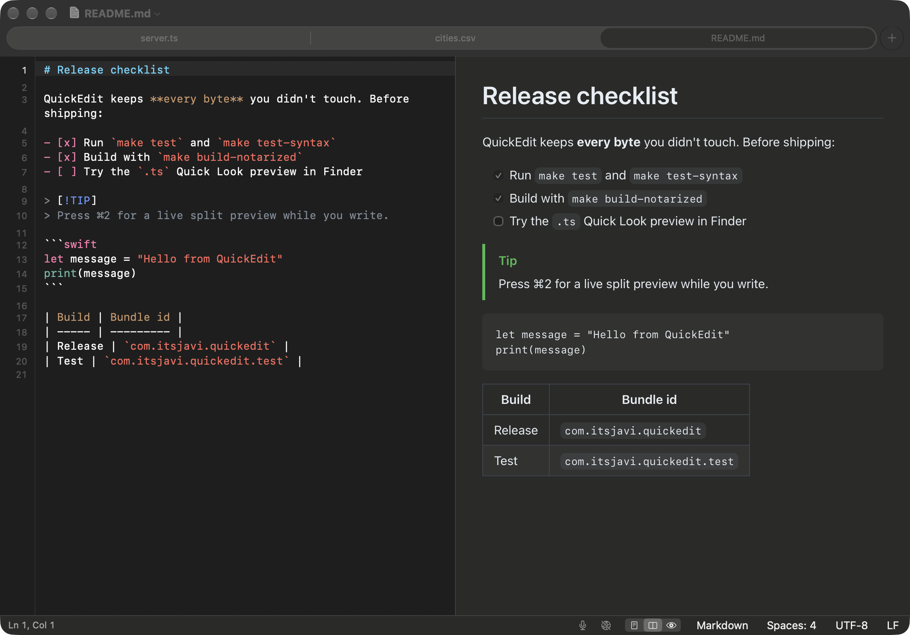
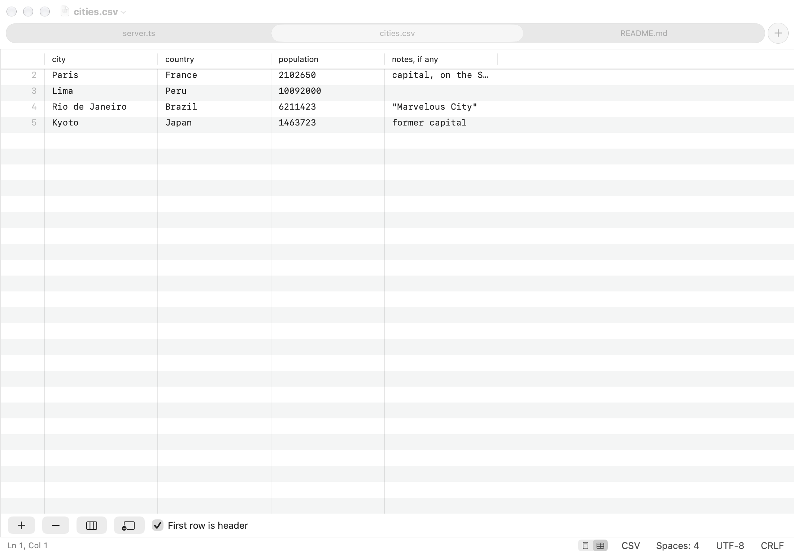
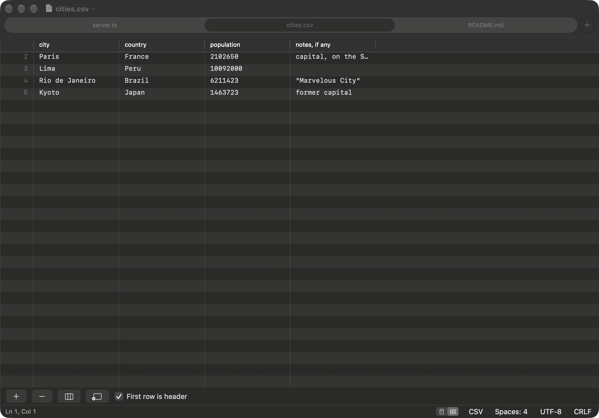

# QuickEdit

A native macOS code viewer and editor for small, quick edits: a modern TextEdit, a lighter Sublime Text. Not an IDE.

| Light                                                       | Dark                                                      |
| ----------------------------------------------------------- | --------------------------------------------------------- |
|  |  |
|  |  |
|       |   |

## Features

- **Files as tabs.** Every file opens as a native window tab (⌘T for a new one). Autosave and version history like
  TextEdit, or explicit ⌘S saving if you prefer (Settings).
- **Syntax highlighting** with tree-sitter for JavaScript/JSX, TypeScript/TSX, CSS, HTML, Markdown, CSV/TSV (rainbow
  columns), JSON/JSONC/JSON Lines, YAML, TOML, Go (+ `go.mod`), Rust, Python, Swift, GDScript and Godot resources and
  shaders, Dockerfile, XML (plists, SVG, Xcode files), INI and config files, shell scripts, Makefiles, SQL, `.env`,
  ignore files and diffs. Logs and `.txt` open as plain text.
- **Lines.** Line numbers, current-line highlight, Go to Line (⌘L), move lines (⌃⌘↑/↓), duplicate (⇧⌘D), delete
  (⌃⇧K), join (⌃J), sort, indent/outdent (⌘] / ⌘[) and toggle comment (⌘/). Soft wrap on or off.
- **Safe edits.** Files are saved byte for byte as they came in, except what you changed:
  - the encoding (UTF-8/16/32 with or without BOM, Windows/ISO Latin, Mac Roman, Shift JIS, …) and line endings
    (LF, CRLF, CR, even mixed) are kept; the status bar shows them and converts them only when you ask;
  - new lines and pasted text use the file's own line ending;
  - indentation is detected per file and follows `.editorconfig` (indent style and size, line endings, trimming,
    final newline); Tab, indent and convert-indentation commands use it;
  - invisible and look-alike characters (zero-width, bidirectional controls, non-breaking and other unusual spaces,
    stray BOMs) are always marked in orange and counted in the status bar; click to jump to the next one;
  - Show Invisible Characters (⌥⌘I) draws spaces, tabs and LF / CRLF / CR line endings distinctly;
  - smart quotes, dashes, autocorrect and spell checking are off;
  - files that can't be decoded exactly open read-only; binary property lists open read-only as XML with a
    Convert to XML button; binary files are refused.
- **Markdown and HTML preview.** Editor, split or preview (⌘1 / ⌘2 / ⌘3), live from unsaved edits. Markdown renders
  like GitHub (tables, task lists, alerts). HTML previews never run scripts; local CSS and images load, remote
  content only when you allow it for that window.
- **CSV and TSV as a table.** Switch a CSV/TSV file to Table (⌥⌘T or the status bar) to edit it like a
  spreadsheet: edit cells, add or delete rows and columns, use the first row as headers. Every change rewrites only the
  cells it touches, so quoting, the delimiter and line endings stay as they were, and ⌘Z undoes it.
- **Voice notes in Markdown.** Record from the status bar or ⌃⌘R: the clip goes to `<file>.md.assets/` next to the
  file, is linked at the caret, plays in the preview and can be transcribed on this Mac.
- **Light and dark.** Follow the system or pick Light or Dark (View › Appearance).
- **Finder and Quick Look.** QuickEdit registers for all the file types above and `.txt`. TypeScript `.ts` files
  (which macOS thinks are videos), YAML, TOML, CSS and Lumiose `.stsx`/`.sjsx` files get a plain-text Quick Look
  preview, and Finder's icons and preview pane show their first lines; real `.ts` videos still play.

## Install

Requires macOS 26 on Apple silicon.

```bash
make install
```

builds the release app and copies it to `/Applications`. To open file types with QuickEdit by default, use
QuickEdit › Make QuickEdit the Default Editor… (Settings › File Types): check the types you want and Apply; unchecking
gives a type back to the app that had it before.

## Develop

| Command                  | What it does                                                         |
| ------------------------ | -------------------------------------------------------------------- |
| `make build`             | Debug build                                                          |
| `make test`              | Core unit tests                                                      |
| `make test-syntax`       | Syntax package tests (grammars, queries, language detection)         |
| `make app`               | Release `build/QuickEdit.app` (ad-hoc signed)                        |
| `make run`               | Debug `QuickEdit Dev.app`                                            |
| `make release`           | App, zip and DMG in `build/release`                                  |
| `make build-notarized`   | Same, signed with your Developer ID, notarized and stapled           |
| `make install-notarized` | Installs the notarized build                                         |
| `make grammars`          | Re-vendors the tree-sitter grammars pinned in the syntax package     |
| `make icon`              | Redraws the app icon                                                 |

SwiftUI + AppKit, Swift 6, SwiftPM (no Xcode project). Agent and contributor notes are in `AGENTS.md`; design
decisions in `backlog/decisions/`.

## Credits

Syntax highlighting uses [tree-sitter](https://tree-sitter.github.io/) through
[SwiftTreeSitter](https://github.com/ChimeHQ/SwiftTreeSitter) and the grammars listed in
`Packages/QuickEditSyntax/Vendor/NOTICES.md`. Markdown rendering uses
[cmark-gfm](https://github.com/swiftlang/swift-cmark).

## License

MIT
