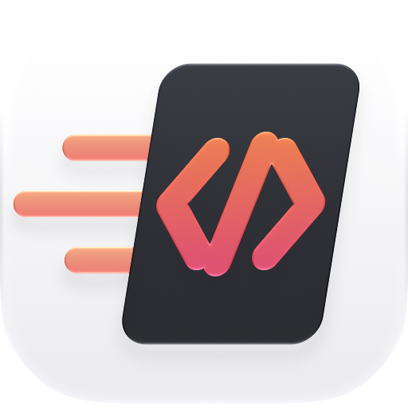
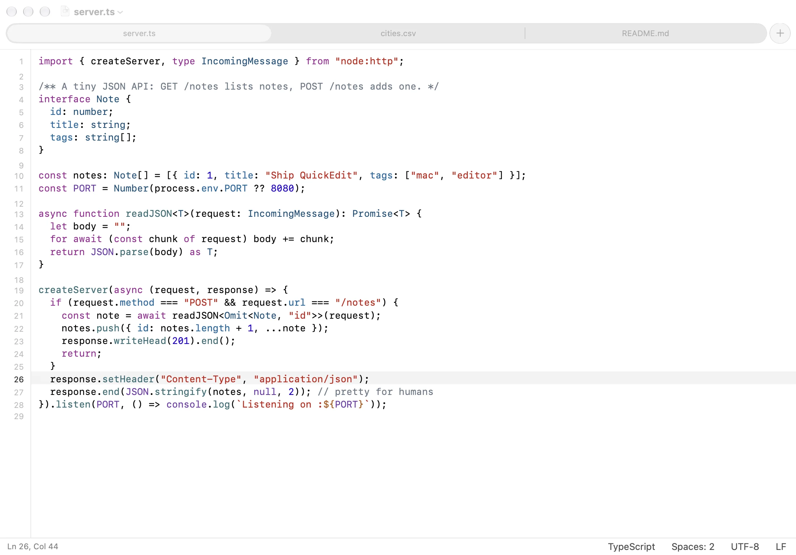
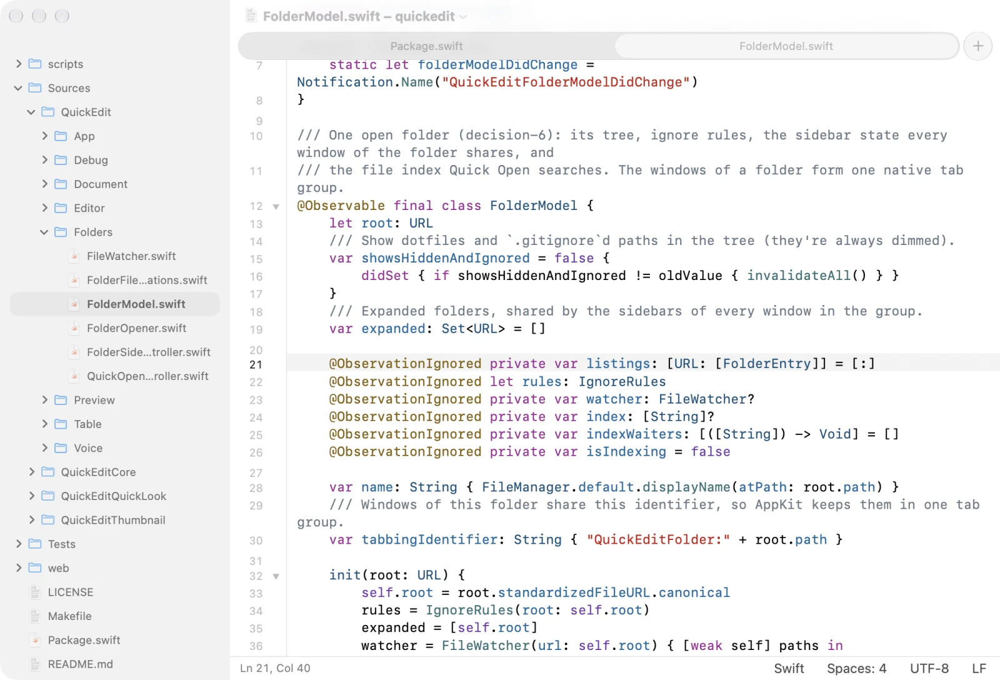
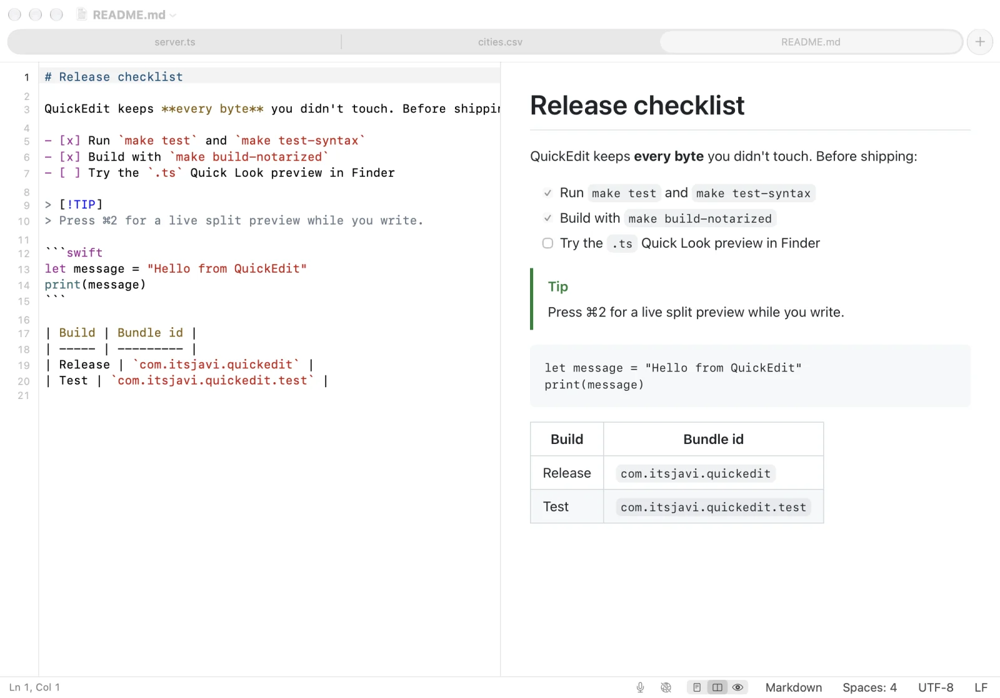
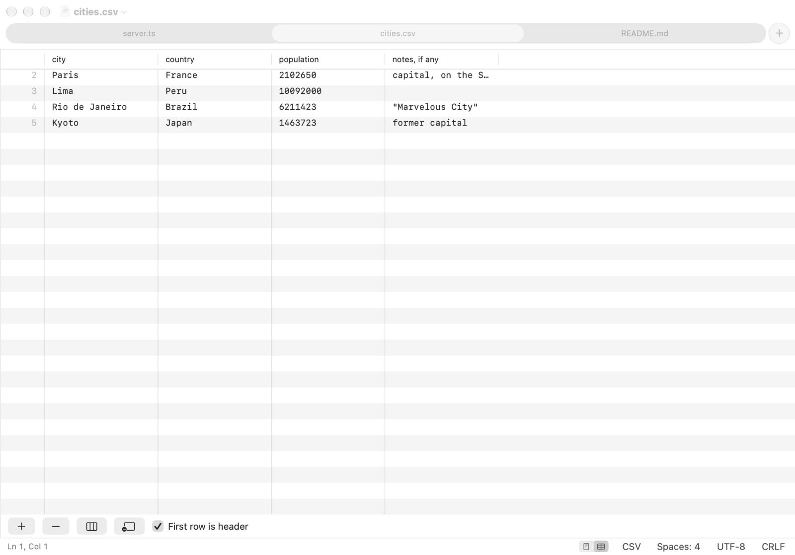

<p align="center">
  
</p>

<h1 align="center">QuickEdit</h1>

<p align="center">
  <strong>Quick, safe edits for code and text files.</strong><br>
  A native Mac code viewer and editor: a modern TextEdit, a lighter Sublime Text, not an IDE.
</p>

<p align="center">
  <a href="https://itsjavi.com/quickedit/">Website</a> ·
  <a href="https://github.com/itsjavi/quickedit/releases/latest">Download</a> ·
  <a href="#features">Features</a> ·
  <a href="#building">Building</a> ·
  <a href="LICENSE">MIT License</a>
</p>

<picture>
  <source media="(prefers-color-scheme: dark)" srcset="web/assets/editor-dark.webp">
  
</picture>

## Why QuickEdit

For the post-IDE era: when agents write most of the code, what's left to do by hand is opening a file, reading it and
changing a line or two. An IDE is too much for that, and TextEdit too little: no highlighting, curly quotes in your
code, and Finder can't even preview a `.ts` file.

I wanted a simple code editor with good defaults and Quick Look support, without the bloat. QuickEdit opens fast,
highlights all the modern languages, previews Markdown and HTML, edits CSV like a spreadsheet, and saves every file byte
for byte as it came in, except what you changed. There's nothing to configure and no extensions to install.

## Features

- **Files as tabs.** Every file opens as a native window tab (⌘T for a new one), and a dot marks the tabs with unsaved
  changes. Autosave and version history like TextEdit, or explicit ⌘S saving if you prefer (Settings).
- **Folders.** File › Open Folder… (⇧⌘O), or drop a folder on QuickEdit: a file tree sidebar (dotfiles and
  `.gitignore`d files hidden until you show them), the folder's files as tabs of one window, ⌘P to open any file by
  name, and New File, New Folder, Rename, Move (drag) and Move to Trash in the tree. Open files follow renames and moves.
  Files and folders get [Material Icon Theme](https://github.com/material-extensions/vscode-material-icon-theme) icons,
  in light and dark variants (or Finder's icons, in Settings).
- **Syntax highlighting** with tree-sitter for JavaScript/JSX, TypeScript/TSX, [Lumiose](https://itsjavi.com/lumiose/) components (`.stsx`/`.sjsx`,
  with their `<style>` blocks as CSS), CSS, SCSS/Sass/Less, HTML, Vue, Svelte, Markdown, CSV/TSV (rainbow columns),
  JSON/JSONC/JSON Lines, YAML, TOML, GraphQL, Protocol Buffers, Terraform/HCL, Nix, SpiceDB schemas, C, C++,
  Objective-C (`.h` by content), C#, Java, Kotlin, Swift, Go (+ `go.mod`), Rust, Zig, Dart, Python, Ruby, PHP, Lua,
  PowerShell, Metal and GLSL shaders, GDScript and Godot resources and shaders, Dockerfile, CMake, XML (plists, SVG,
  Xcode files), Xcode `.xcconfig`, `.strings` and `.pbxproj`, INI and config files, shell scripts, Makefiles, SQL,
  `.env`, ignore files and diffs. Logs and `.txt` open as plain text.
- **Safe edits.** Files are saved byte for byte as they came in, except what you changed:
  - the encoding (UTF-8/16/32 with or without BOM, Windows/ISO Latin, Mac Roman, Shift JIS, …) and line endings
    (LF, CRLF, CR, even mixed) are kept; the status bar shows them and converts them only when you ask;
  - new lines and pasted text use the file's own line ending, and indentation is detected per file and follows
    `.editorconfig` (indent style and size, line endings, trimming, final newline);
  - invisible and look-alike characters (zero-width, bidirectional controls, unusual spaces, stray BOMs) are always
    marked in orange and counted in the status bar; Show Invisible Characters (⌥⌘I) draws spaces, tabs and line
    endings;
  - a file another app changes reloads by itself when you have no unsaved edits, and ⌘Z brings back what was
    showing; with unsaved edits a bar above the text offers Reload or Keep My Edits, and nothing is replaced until you
    choose;
  - smart quotes, dashes, autocorrect and spell checking are off;
  - files that can't be decoded exactly open read-only, binary property lists open read-only as XML with a Convert to
    XML button, and binary files are refused.
- **Markdown and HTML preview.** Editor, split or preview (⌘1 / ⌘2 / ⌘3), live from unsaved edits. Markdown renders
  like GitHub (tables, task lists, alerts). HTML previews never run scripts; local CSS and images load, remote content
  only when you allow it for that window.
- **CSV and TSV as a table.** Switch a CSV/TSV file to Table (⌥⌘T or the status bar) to edit it like a spreadsheet:
  edit cells, add or delete rows and columns, use the first row as headers. Every change rewrites only the cells it
  touches, so quoting, the delimiter and line endings stay as they were, and ⌘Z undoes it. Files over 25 MB open
  as text only.
- **Lines.** Line numbers, current-line highlight, Go to Line (⌘L), move lines (⌃⌘↑/↓), duplicate (⇧⌘D), delete
  (⌃⇧K), join (⌃J), sort, indent/outdent (⌘] / ⌘[) and toggle comment (⌘/). Soft wrap on or off.
- **Code folding** for every language with a tree-sitter grammar (JSON, YAML, CSS, JS/TS, C/C++, Swift, Python,
  Markdown, HTML, XML…), from the gutter or View › Folding (⌥⌘← / ⌥⌘→, all with ⇧). Folding never changes the file;
  editing inside a fold, finding text in it or going to one of its lines opens it.
- **Voice notes in Markdown.** Record from the status bar or ⌃⌘R: the clip goes to `<file>.md.assets/` next to the
  file, is linked at the caret, plays in the preview and can be transcribed on your Mac.
- **Finder and Quick Look.** TypeScript `.ts` files (which macOS thinks are videos), YAML, TOML, CSS and Lumiose files
  get a plain-text Quick Look preview, and Finder's icons and preview pane show their first lines; real `.ts` videos
  still play. Settings › File Types makes QuickEdit the default editor for the types you check, and gives a type back
  to its previous app when you uncheck it.
- **Light and dark.** Follow the system or pick Light or Dark (View › Appearance).

<table>
  <tr>
    <td colspan="2">
      <picture>
        <source media="(prefers-color-scheme: dark)" srcset="web/assets/folders-dark.webp">
        
      </picture>
    </td>
  </tr>
  <tr>
    <td colspan="2" align="center">Folders, with a file tree and Quick Open</td>
  </tr>
  <tr>
    <td width="50%">
      <picture>
        <source media="(prefers-color-scheme: dark)" srcset="web/assets/preview-dark.webp">
        
      </picture>
    </td>
    <td width="50%">
      <picture>
        <source media="(prefers-color-scheme: dark)" srcset="web/assets/table-dark.webp">
        
      </picture>
    </td>
  </tr>
  <tr>
    <td align="center">Markdown and HTML preview</td>
    <td align="center">CSV and TSV as a table</td>
  </tr>
</table>

## Requirements

- macOS 26 or later on Apple silicon
- Xcode 26 or later to build

## Install

Download the DMG from the [latest release](https://github.com/itsjavi/quickedit/releases/latest) and drag QuickEdit to
Applications. It's signed and notarized, and updates itself (QuickEdit › Check for Updates…).

## Building

```bash
git clone https://github.com/itsjavi/quickedit.git
cd quickedit
make install  # builds build/QuickEdit.app and copies it to /Applications
```

Other targets: `make app` (release build only), `make run` (debug build), `make test` and `make test-syntax` (unit
tests), `make grammars` (re-vendors the pinned tree-sitter grammars), `make icon` (redraws the app icon) and
`make build-notarized` (signed and notarized app, zip and DMG in `build/release`; needs a Developer ID Application
identity and a `notarytool` Keychain profile). `make bump V=minor PUSH=1` tags a release for GitHub Actions to build and
publish; see [docs/releasing.md](docs/releasing.md).

AppKit, Swift 6 and SwiftPM, with no Xcode project. See [AGENTS.md](AGENTS.md) for the project layout, build variants
and test hooks. The website lives in [`web/`](web) and is deployed to GitHub Pages on every push to `main` that touches
it.

## Credits

Syntax highlighting uses [tree-sitter](https://tree-sitter.github.io/) through
[SwiftTreeSitter](https://github.com/ChimeHQ/SwiftTreeSitter) and the grammars listed in
[NOTICES.md](Packages/QuickEditSyntax/Vendor/NOTICES.md). File and folder icons are a subset of the
[Material Icon Theme](https://github.com/material-extensions/vscode-material-icon-theme) (MIT,
[license](Resources/MaterialIcons/LICENSE.txt)). Markdown rendering uses
[cmark-gfm](https://github.com/swiftlang/swift-cmark), and updates use [Sparkle](https://sparkle-project.org).

## License

[MIT](LICENSE)
